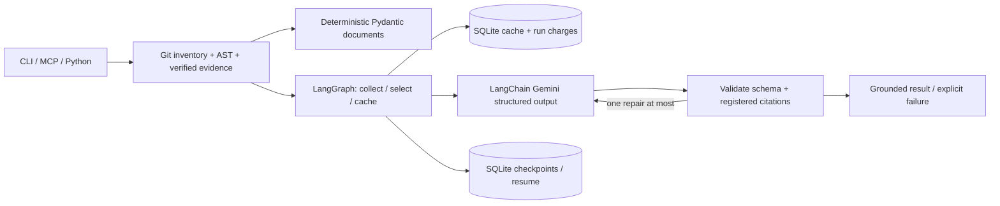

# RepoTrail

Read a local Python Git repository, retrieve verified source, compare local commits, and
optionally ask Gemini for explanations or review findings grounded in that evidence.
Use it through Python, a CLI, or a local MCP stdio server. Inspected source is **never
executed, imported, tested, installed, or modified**. AI requires an explicit command.

## Install

Python **3.14.x** and Git **2.48+** are required. Actual development verification used
Windows, Python 3.14.7 and Git 2.55.0.windows.5. Windows/Linux 3.14 CI is configured;
a remote CI run and Linux execution have not been observed in this workspace.

```powershell
# In this checkout, reuse the existing .venv. For a fresh checkout only:
python -m venv .venv
.\.venv\Scripts\python.exe -m pip install -e '.[ai,mcp,dev]'
# Core only: pip install . ; extras: .[ai], .[mcp], .[dev]
.\.venv\Scripts\repotrail.exe --help
```

`requirements-dev.lock` is the actual pinned Windows/Python 3.14 development resolution,
without fabricated hashes; install it then install this project with `--no-deps` to
recreate that scope. Linux CI resolves the declared compatible extras independently.
Dependencies belong in this project's environment, never in a repository being inspected.

## Try the offline demo

These commands create **only** a new empty `.local/demo` synthetic repository, including
two fixture commits, an intentional discount-formula change, a binary file, a rename,
and dirty/untracked source. They do not change this project's Git history.

```powershell
$py = '.\.venv\Scripts\python.exe'
& $py -m repotrail demo .local\demo --json
& $py -m repotrail inspect .local\demo --json
& $py -m repotrail symbols .local\demo --json
& $py -m repotrail overview .local\demo --json
& $py -m repotrail context .local\demo pricing.py total_price --json
& $py -m repotrail history .local\demo --limit 10 --json
& $py -m repotrail changes .local\demo HEAD~1 HEAD --json
```

The final comparison exits 1 because the binary file is explicitly incomplete evidence.
Replace `.local/demo` with your Git **working-tree root** for ordinary use. Use relative
POSIX paths such as `src/package/module.py` for context; `--definition-line N` resolves
duplicate qualified names. `--json` prints the validated document. Without it, a human
renderer presents every field from the same result. Unicode JSON is ASCII escaped for
Windows console compatibility.

| Command | Result / exit contract |
| --- | --- |
| `inspect ROOT [--max-files N]` | Compatible M01 inventory schema `1`; 0 success, 2 fatal. |
| `symbols ROOT` | Compatible M02 `python_source_map` schema `1`; 0 complete, 1 incomplete, 2 fatal. |
| `overview ROOT` | Inventory, AST counts, README, TOML declarations, recent local history. |
| `context ROOT PATH QUALIFIED_NAME [--definition-line N]` | Exact decorator-inclusive numbered source, SHA-256 and citation; ambiguity/not-found explicit. |
| `history ROOT [--ref HEAD] [--limit 20]` | Bounded local metadata with immutable resolved commit. |
| `changes ROOT BASE HEAD` | Committed endpoint trees, statuses, hunks, old/new references and syntactic symbol overlap. |
| `explain ROOT [--task explain_project\|explain_changes\|review_diff]` | Explicit Gemini workflow; change modes require `--base-ref REF --head-ref REF`. |
| `resume ROOT RUN_ID` | Recreate workflow from persistent SQLite checkpoints; stale evidence/config rejected. |
| `cache-prune ROOT [--keep 100]` | Delete older app runs/cache and corresponding graph checkpoints. |
| `mcp --repo ROOT [--enable-ai]` | Bound-root stdio server; stdout is protocol only. |

New evidence commands exit 0 complete, 1 a valid incomplete/unavailable result, 2 fatal
with stderr and no partial stdout. AI exits 0 completed, 1 failed/incomplete/interrupted/
stale typed result, 2 invocation/setup error. `demo`/`cache-prune` exit 0 or 2.

## Optional AI

```powershell
$env:GEMINI_API_KEY = '<your-key>' # process environment; never commit it
$env:REPOTRAIL_STATE_DIR = Join-Path $PWD '.local\state'
& $py -m repotrail explain .local\demo --task explain_project --json
& $py -m repotrail explain .local\demo --task review_diff --base-ref HEAD~1 --head-ref HEAD --json
& $py -m repotrail explain .local\demo --run-id lesson --pause-before-generate --json
& $py -m repotrail resume .local\demo lesson --json
& $py -m repotrail cache-prune .local\demo --keep 50 --json
```

`GOOGLE_API_KEY` is also accepted; `GEMINI_API_KEY` takes precedence. The project never
loads `.env`. `--model` supports explicit stable `gemini-3.8-flash` (default),
`gemini-3.6-flash`, or `gemini-3.5-flash-lite`; account availability is still required.
See [Gemini model documentation](https://ai.google.dev/gemini-api/docs/models).
The current account key and model metadata are verified. Verification found and fixed an
unsupported `minimal` thinking level; the default is now `low`, supported by all configured
Flash models. Subsequent bounded synthetic generation requests returned server errors,
including HTTP 503 high demand. Successful live Gemini output remains unverified because
of that service response. Scripted evaluation is labeled separately.

Each workflow allows at most **two actual provider attempts**, including a repair or
transient retry. The installed adapter sets `retries=1` (one total SDK attempt), timeout
30 seconds and output limit 1,500 tokens. `GenerationConfig.thinking_level` defaults to
`low`; it is validated and included in cache/resume fingerprints. A durable SQLite charge precedes each call;
crash recovery may conservatively consume an attempt without a usable response. This
does **not** promise exactly-once billing. `--max-attempts 1` can lower the run limit.
Selected source/document text and metadata/prompt/schema text each have a 32 KiB bound.
Omissions, source diagnostics, usage when reported, timings and cache status are returned.

Cache keys include canonical repository identity, complete observed evidence manifest,
exact selected source/reference package, task, backend/provider/model, generation settings
and prompt/output/selection versions. Unstaged Python edits and untracked membership can
invalidate with unchanged HEAD. Cached schemas and citations are revalidated. Resume must
use the same root, selected evidence, refs, model, attempt setting and policy versions.
Fresh runs with unchanged evidence can hit cache with zero provider attempts.

Default state is user-local: `%LOCALAPPDATA%/RepoTrail`, macOS Application Support, or
`$XDG_STATE_HOME/repotrail` (fallback `~/.local/state/repotrail`). State is rejected inside
an inspected repository unless intentionally configured in an excluded directory such as
`.local`. Separate `cache.sqlite3` and `checkpoints.sqlite3` contain source/model output;
treat them as local private data. Cache retention is 128 entries, run retention 256;
prune older runs explicitly. Remote tracing is off; `REPOTRAIL_LOG_LEVEL=INFO` enables
secret-safe JSON node timing logs on stderr. No hosted account is needed for local state.

## MCP integration

```powershell
& $py -m repotrail mcp --repo .local\demo
# In another shell, exercise the official Python SDK client:
& $py examples\mcp_client.py .local\demo
```

The tested SDK is **MCP 2.3.0**, using `MCPServer` and the official Python stdio client;
Node is not required. Read-only/idempotent tools: `get_project_overview`,
`get_symbol_context(path, qualified_name, definition_line=None)`, and
`summarize_changes(base_ref, head_ref)`. With `--enable-ai` only, `explain_project` and
`review_diff(base_ref, head_ref)` are also registered. AI tools may spend quota and write
local state, so their annotations do not promise read-only/idempotent operation.
Typed responses contain `ok`, `data`, `error`; inspect completeness and workflow status.

[Client config template](examples/mcp-config.json) and
[agent usage instructions](examples/AGENT_USAGE.md) explain setup and citation use.
No particular desktop host configuration was edited or tested. This is a local stdio
agent interface; hosted ChatGPT connectivity, host-specific packaging and publication
would require separate adapters.

## Architecture and boundaries



Pydantic makes contracts explicit; LangChain supplies messages and the real structured
Gemini adapter; LangGraph implements conditional repair and persistent control flow;
SQLite gives local cache/run/checkpoint storage; MCP makes the same APIs callable by
coding agents. Git subprocesses provide local object access; `ast` observes Python syntax.
[Architecture and decisions](docs/architecture.md) explains alternatives and limitations.

Inventory uses Git's index plus nonignored untracked paths, NUL records and normalized
relative paths. Tracked means present in the index, including intent-to-add. Deleted working
files are omitted. Known environment/cache/build directories, credential-like filenames,
symlinks/gitlinks/linked parents/Windows reparse points are excluded. Filename filters are
not general secret detection: AI explicitly sends selected eligible contents to Gemini.
README/comments/commit subjects/patches are untrusted data and cannot authorize actions.

| Bound | Default |
| --- | --- |
| Inventory files / Git candidate records per pass | 10,000 / 20,000 |
| Each Git subprocess | 8 MiB stdout / 10 seconds |
| Python candidates / each source / aggregate reads | 500 / 1 MiB / 10 MiB |
| AST node visits per source | 50,000 (after parse) |
| History / eligible changed files | 100 / 100 |
| Returned patch + source context | 1 MiB combined |
| README/TOML read / declaration excerpt | 64 KiB / 16 KiB |

Aggregate overflow is fatal; unavailable individual sources return diagnostics and
incomplete results. Comparison reads existing local blobs, never checks out or fetches.
It disables external diff/textconv/replacements, ignores link contents, and reports
renames as deletion+addition. `BASE..HEAD` is a separate reachability log, not complete
causation. Dirty/untracked source appears in current overview; **changes/review compare
two commits only**. Binary evidence, unsupported encodings, absent/legacy packaging,
parse errors and excerpts are disclosed. TOML declarations are not resolved dependencies.

Source references bind relative path, inclusive physical line range and raw-byte SHA-256;
historical references additionally bind commit/blob. Decorators are included. Lexical
symbol names and changed-line overlaps are not a call graph or stable cross-edit identity.
Schema/citation validation proves structural grounding, not semantic correctness. Metadata
rechecks are best effort, not an atomic filesystem snapshot or hostile-code sandbox.

## Verify and contribute

```powershell
New-Item -ItemType Directory -Force .local\tmp | Out-Null
$env:TEMP = Join-Path $PWD '.local\tmp'; $env:TMP = $env:TEMP
$env:PYTEST_DISABLE_PLUGIN_AUTOLOAD = '1'
& $py -m pytest -q
& $py -m ruff check src tests evals examples
& $py -m ruff format --check src tests evals examples
& $py -m mypy src\repotrail
& $py -m evals.run --output .local\evaluation.json
& $py -m build
& $py -m pip check
```

Tests/evaluations use synthetic repositories and injected, explicitly labeled scripted
models. They do not execute inspected code or make provider calls. Windows symlink tests
skip if the OS denies privilege. See [CONTRIBUTING](CONTRIBUTING.md) and the offline
[CI workflow](.github/workflows/ci.yml). An explicit paid smoke example is available as
`python examples/live_smoke.py --live --directory .local/live --output .local/live.json`;
its durable ledger caps that directory at three build-wide calls. The authorized build
ledger is already exhausted; use your own fresh smoke directory only when you choose to
perform a later live check with working credentials. Never remove charges to retry a run.

MIT is prepared for project-owned code; the owner should review attribution before public
publication. No package, repository, plugin or service is published automatically.
