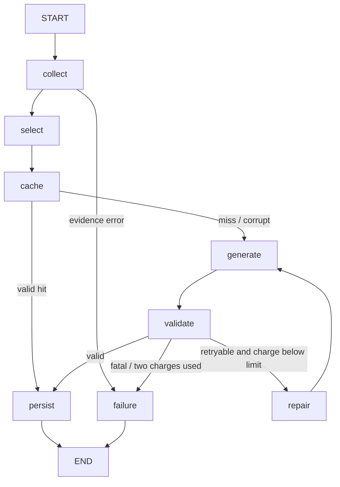

# Architecture and decisions

## Evidence before interpretation

`git.py` runs bounded argument-list subprocesses with routing environment variables,
optional locks, fsmonitor, lazy fetch, external helpers and replacements disabled.
`inventory.py` shares one eligibility policy across current source and historical paths.
`analysis.py` reads once, hashes the same bytes it decodes, and checks path/descriptor
metadata before/after. `python_parser.py` uses an iterative lexical AST traversal.

`evidence.py` builds overview and exact declaration excerpts; `history.py` resolves refs
before reading committed endpoint trees and blobs. `product_models.py` keeps new documents
separate from inventory/source-map schemas. Reference IDs are `src:` plus a canonical SHA-256 of the
typed path/range/content/revision fields. Excerpts validate contiguous actual source lines.
Deletion evidence does not depend on current filesystem existence. Historical custom
virtual-environment marker detection is unavailable; shared known directory/filename and
Git mode exclusions still apply. Git configuration/ignore files remain Git inputs.

The parser observes definitions/import statements, without runtime resolution, dependency
installation, call graphs or imports of inspected code. Its 50,000-node budget applies
after bounded source parsing. A syntax overlap is evidence; runtime impact is inference.

## Selection and model boundary

`selection.collect_evidence` hashes the full deterministic manifest, selects README/TOML
and the first declaration in up to three path-ordered Python files for project explanation,
or old/new hunk excerpts for changes. Source is retained as whole numbered lines within
32 KiB including reference headers; metadata is reduced with explicit omission reasons.
`provider.build_messages` additionally bounds system text, registry, schema and repair data
to 32 KiB. Overflow fails before a provider attempt. Repair can fail if prior output no
longer fits; this is explicit, never an unbounded prompt. Selection is deterministic and
does not claim coverage of all files. Duplicate selected IDs are removed.

`GenerationConfig` is secret-free. `create_model` constructs the single real Gemini
adapter from process credentials only. LangChain supplies prompt messages and structured
Pydantic output; there are no execution/search/write tools. The SDK's installed retry
semantics make `retries=1` one total request. LangSmith tracing is disabled at invocation.
Provider failures return stable codes and exception class names, never raw exception text.
The reasoning level defaults to `low`, which the configured stable Flash models support;
Gemini 3.8 Flash rejects `minimal`. This setting is explicit in GenerationConfig and thus
changes cache/resume fingerprints. Offline tests construct the actual installed adapter's
request for all configured model IDs. HTTP 5xx responses are typed `provider_unavailable`
and may use the one remaining graph attempt, while configuration failures are terminal.

## Persistent control flow

The real compiled `StateGraph` has nodes:

`RunState` contains run/request, serialized evidence, cache key/status, candidate/answer,
validation errors, usage, used IDs and input sizes. Clients/connections/keys are service
dependencies, never checkpoint state. Task-specific output models separate observations,
inferences and review findings. `validate_answer` validates schemas and every registered
citation against retained typed excerpts. It cannot verify the model's reasoning.

App SQLite (`cache.sqlite3`, `user_version=1`) contains `cache_entries`, `runs`, and
`run_events`. Queries use parameters, short transactions, and connection closure. An
atomic attempt increment commits **before** any provider request, with no write transaction
held across the network. A crash between charge and call conservatively consumes quota.
An unknown schema version is rejected rather than reset. Local state is trusted private
data; do not open untrusted checkpoint files. JSON-plus serialization has no pickle fallback.

`checkpoints.sqlite3` is managed separately by `SqliteSaver`. Graph `thread_id=run_id`;
the app run stores immutable evidence/config fingerprints and the selected evidence.
Cache fingerprints include canonical repository root, full observed manifest, exact
bounded selected package, task/backend/provider/model, generation settings, and policy
versions. HEAD alone is insufficient. Cache hits are schema/citation revalidated.

Resume recreates services, recollects evidence, compares fingerprints and then continues
the saved graph. Changed configuration/root/source/refs reject as stale. Run IDs cannot
be reused to erase charges. A crash before evidence or the first checkpoint requires a
new run while retaining the original charges. Up to 256 app runs and 128 cache entries
are retained. `cache-prune` deletes older app rows and corresponding checkpointer threads;
interruption during cross-database pruning can leave orphan checkpoints until later
maintenance. There is no cross-database atomicity or exactly-once provider billing claim.

## Why these choices

| Problem | Choice | Reasonable alternative | Reason / limitation |
| --- | --- | --- | --- |
| Discover repository files | Git index + untracked `ls-files -z` | Recursive directory walk | Honors Git membership/ignores and unusual names; Git/config must be available. |
| Understand Python syntax | stdlib AST + tokenized decorator starts | Regex or full runtime analysis | Lexical scopes/ranges without execution; no runtime call graph. |
| Bind evidence to content | Raw-byte SHA-256 + metadata rechecks | HEAD or mtime only | Detects dirty/encoding changes; not an atomic snapshot. |
| Enforce contracts | Pydantic frozen strict models | Unvalidated dictionaries | Invariants at boundaries; schema validity is not semantic truth. |
| Integrate model | LangChain Google adapter | Direct Google SDK | Actual message/structured-output boundary shared with graph; extra dependency/retry semantics need tests. |
| Branch and resume | LangGraph + SQLite saver | Simple sequential functions | Conditional repair and durable checkpoints meet requirements; more state machinery. |
| Persist locally | SQLite files | Hosted database | No server/account needed; single-user/local trusted-state scope. |
| Agent interface | Official MCP v2 stdio | CLI-only subprocess calls | Typed discoverable tools reuse APIs; host setup still required. |
| Fit context | Deterministic excerpts | Embeddings/vector database | Small bounded selection with traceable omissions; may omit relevant distant code. |
| Compare renames | Disable rename detection; D+A | Similarity detection | Predictable paths/bounded work; loses rename identity. |

`cli.py` and `mcp_server.py` call these APIs directly. Optional integrations import lazily.
MCP tools bind a startup root; callers cannot choose arbitrary roots, commands or output
paths. Deterministic tool annotations are read-only/idempotent. Explicit AI tools advertise
quota/state effects. Stdout is reserved for protocol; local timing logs go to stderr.

## Primary references

Implementation checked the current [LangChain models](https://docs.langchain.com/oss/python/langchain/models),
[Google adapter](https://docs.langchain.com/oss/python/integrations/chat/google_generative_ai),
[LangGraph Graph API](https://docs.langchain.com/oss/python/langgraph/graph-api),
[persistence](https://docs.langchain.com/oss/python/langgraph/persistence),
[official MCP Python SDK](https://py.sdk.modelcontextprotocol.io/),
[Git diff](https://git-scm.com/docs/git-diff), and
[revision verification](https://git-scm.com/docs/git-rev-parse), plus actual installed signatures.
